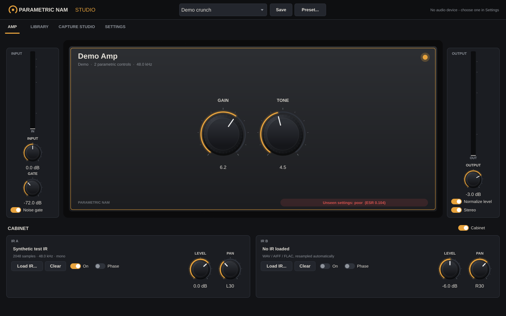
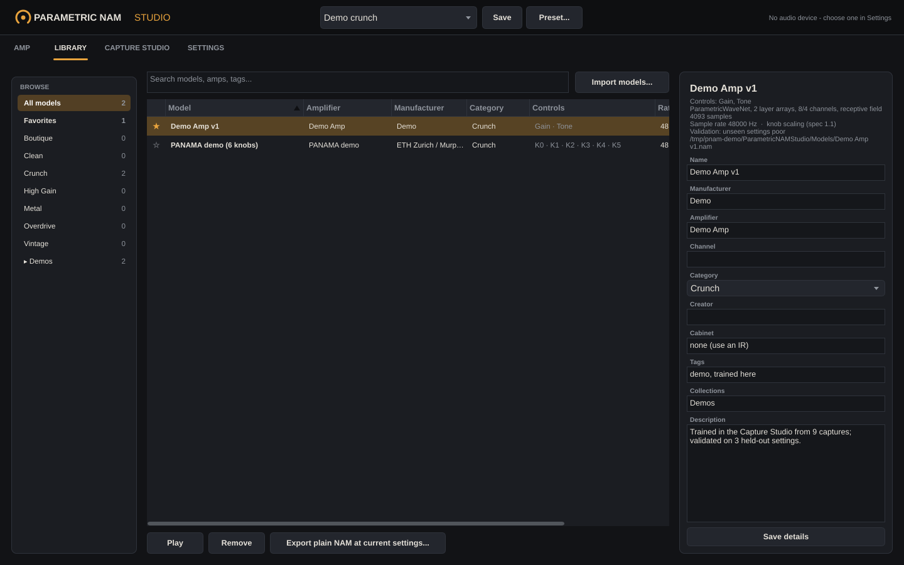
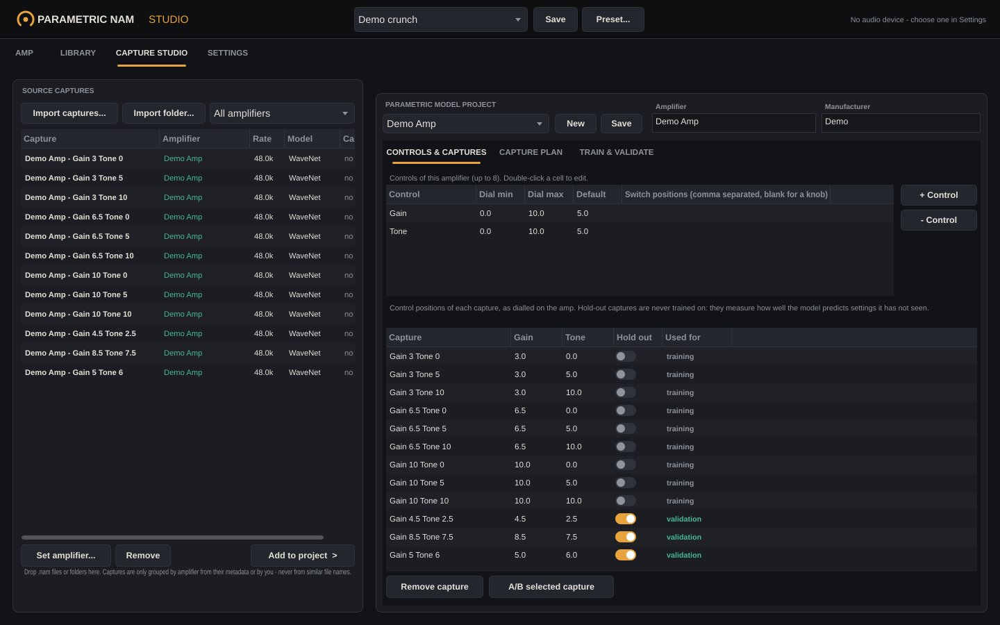
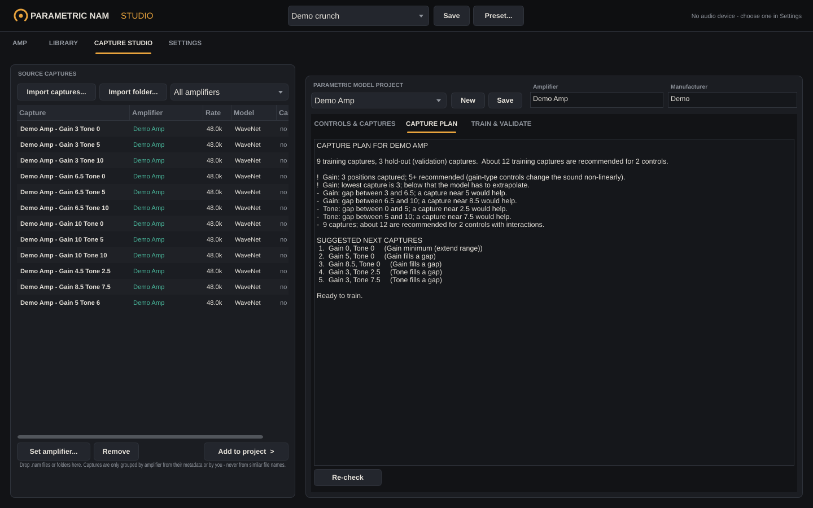
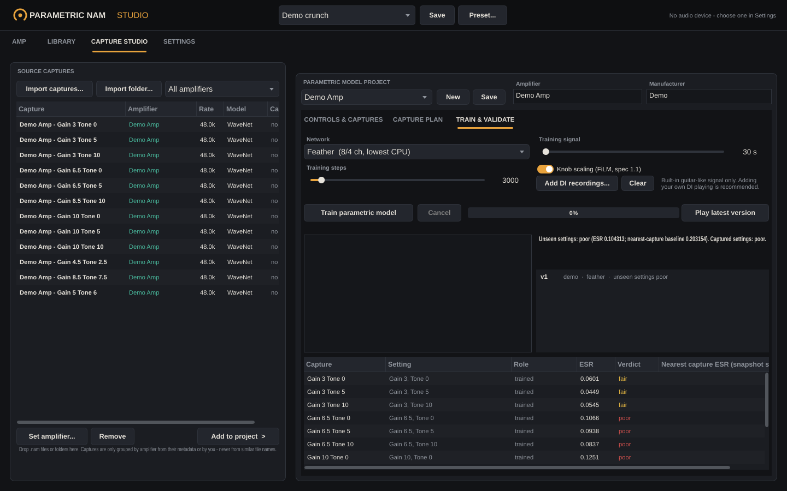

# Parametric NAM Studio

A desktop guitar amplifier application (macOS and Windows) whose **only** amp engine is
**Parametric Neural Amp Modeler** models: one neural network per amplifier, conditioned on the
amp's real controls, trained from several ordinary NAM captures of that same amplifier.

No conventional amp simulation, no static snapshot switching as the playable amp. Ordinary NAM
files are training material and A/B references; the library only plays parametric models.



## Status — what works today (v0.1.0)

| Area | State | Evidence |
|---|---|---|
| NAM playback (NeuralAmpModelerCore, pinned) | working | `plain_nam_loads_as_source_capture` |
| Parametric playback (`ParametricWaveNet`, spec v1.1 incl. `knob_scale`) | working | nulls against PyTorch reference output to **2.6e-7** at block sizes 16–4096 |
| Built-in trainer: several NAM captures → one control-conditioned model | working | exact gradients (finite-difference check, 2e-4), exported model runs identically in NAM core (1e-8) |
| Interpolation between captured settings | working, quality depends on training budget | see *Measured results* |
| Capture planner (gaps, missing ends, control interactions, suggested captures) | working | `planner_*` tests |
| Capture library: import files/folders, metadata, duplicates, cab detection, grouping | working | `capture_library_*` test |
| Model library: categories, favourites, tags, collections, search, sort | working | `model_library_*` test |
| Real-time engine: own-rate inference, band-limited SRC 44.1–192 kHz, smoothing, click-free switching, gate | working | `resampler_*`, `engine_*`, `model_switch_*` tests |
| Dual IR cabinet (level, pan, phase, blend), double-cab warning | working | in the app; IR convolution is JUCE's |
| Presets (create, rename, duplicate, delete, import, export, exact recall) | working | `preset_recall_is_exact` |
| A/B against a source capture | working | Capture Studio → *A/B selected capture* |
| Desktop app (JUCE) | builds and runs on Linux here; macOS/Windows via CI | screenshots below |
| macOS DMG / Windows installer | scripted in CI | `.github/workflows/build.yml` |
| Auto-update | **not done** (download new releases from GitHub Releases) | — |
| GPU (PyTorch) trainer | **not done** — the built-in trainer is CPU (Eigen) | — |
| Signed + notarised macOS builds | needs your Developer ID secrets; CI signs ad-hoc otherwise | — |

### Measured results

Closed-loop test with known ground truth (`parametric_training_predicts_unseen_settings`):
12 "captures" of one amp are plain NAM snapshots of the PANAMA demo parametric model at a grid
of two controls; 9 are trained on, 3 settings are held out.

| | ESR on unseen settings |
|---|---|
| Parametric model (Feather net, 3000 steps, ~4 min on 2 CPU cores) | **0.108** |
| Switching to the nearest captured snapshot | 0.203 |

So the trained model already predicts between captures better than snapshot switching, but at
this tiny training budget it is **"poor" by the app's own scale** (excellent ≤ 0.01, good ≤ 0.03,
fair ≤ 0.08). For a real amp use the Standard network, 10 000+ steps and your own DI playing as
training signal. The app never labels a model accurate unless it has hold-out captures and passes.

## How it works

```
Source captures (plain .nam, same amp, different control settings)
        │  render the training signal through each one (NAM core)
        ▼
 targets y_i  at settings g_i ──►  one WaveNet  y = f(audio, g)  trained on all at once
                                    (input_mixin sees [audio, knobs]; optional knob_scale = FiLM)
        ▼
 ParametricWaveNet .nam  ──►  validated on held-out captures  ──►  library  ──►  amp page knobs
```

* **Format**: [`ParametricWaveNet`](https://github.com/jojopas/parametric-nam/blob/main/SPEC.md)
  (MIT): a standard NAM WaveNet whose conditioning input is widened to `1 + N` rows. NAM core runs
  it unmodified; hosts that don't know knobs refuse it rather than misplay it. Plain NAM files are
  never relabelled as parametric. Any setting can be exported back to a plain NAM file.
* **Training (capture distillation)**: because the targets are neural captures, the dry signal can
  be anything; the built-in signal is synthesised guitar playing (single notes, chords, palm
  mutes, soft-to-hard picking) plus sweeps and noise. Every 5th second is held back for
  validation. Loss: ESR + pre-emphasised ESR, Adam, cosine schedule, gradient clipping.
* **Validation**: per capture ESR on unseen audio; for hold-out captures also the
  nearest-captured-snapshot baseline. Harmonics, response and gain curves: `pnam analyze`.
* **Real time**: models run at their training rate; a windowed-sinc resampler converts to and
  from the interface rate (passband ±0.01 dB to 18 kHz, aliasing < −90 dB). Controls are smoothed
  and applied every 32 samples. Models load off the audio thread and crossfade in over 30 ms. The
  audio callback does not allocate, lock or touch files.

## Using it

1. **Capture Studio → Import captures/folder**. Group captures by amplifier (from metadata, or
   *Set amplifier…*). Grouping is never inferred from file names.
2. **New** project, define the controls (name, dial range, or switch positions; up to 8).
3. Enter each capture's control positions. Mark 1–3 captures **Hold out**.
4. **Capture plan** lists what is missing and suggests settings to capture next.
5. **Train & validate**. The model is versioned (`<amp> vN.nam`), added to the Library, and plays
   with its own controls on the Amp page.

Command line (same engine): `pnam info|render|snapshot|plan|train|analyze|signal` — see
`Source/cli/pnam.cpp`.

## Building

Requirements: CMake ≥ 3.22, a C++20 compiler (Xcode 15+, Visual Studio 2022), network access
for the first configure (dependencies are fetched at pinned versions).

```sh
cmake -S . -B build -DCMAKE_BUILD_TYPE=Release
cmake --build build -j
PNAM_FAST_TESTS=1 ./build/Tests/pnam_core_tests      # full accuracy test: drop PNAM_FAST_TESTS (~5 min)
```

macOS universal: add `-G Xcode -DCMAKE_OSX_ARCHITECTURES="arm64;x86_64"`. Engine/trainer only:
`-DPNAM_BUILD_APP=OFF`. Installers: `Build/installer/make_dmg.sh`, `Build/installer/windows.iss`.
CI builds, tests and packages both platforms on every push and publishes releases for `v*` tags.

## Repository layout

| Folder | Contents |
|---|---|
| `NAMCore/` | builds NeuralAmpModelerCore; NAM file inspection; WAV I/O |
| `ParametricEngine/` | ParametricWaveNet loader, playable/source model loading, snapshot export |
| `ModelTraining/` | trainable WaveNet (forward/backward), trainer, training signal, validation, export |
| `ModelLibrary/` | capture library, model library, Studio projects, capture planner |
| `AudioEngine/` | real-time amp stage, resampler, gate, presets, JUCE device engine |
| `CabinetEngine/` | dual IR convolution |
| `UserInterface/` | JUCE pages: Amp, Library, Capture Studio, Settings |
| `Source/` | app entry point (`--screenshots DIR` renders every page), `cli/pnam` |
| `Tests/` | automated tests |
| `Build/` | installers, demo-content generator |
| `Resources/` | icon, MIT test fixtures |

## Milestones

1. ✅ Real-time NAM + parametric playback, nulls against PyTorch
2. ✅ Control-conditioned trainer with exact gradients, held-out validation
3. ✅ Capture/model libraries, planner, Studio, presets, dual IR, desktop UI
4. ⏳ CI: confirm macOS/Windows builds and installers on GitHub runners
5. ☐ Training quality: longer schedules, GPU trainer (PyTorch, same file format), ESR targets ≤ 0.03 on real amps
6. ☐ Input calibration (dBu), loudness metadata per setting, oversampling study
7. ☐ Update notifications, signed/notarised releases
8. ☐ Plugin (VST3/AU) build of the same engine

## Screenshots

| | |
|---|---|
|  |  |
|  |  |

Screenshots use generated demo content (`Build/make_demo_content.py`): captures are snapshots of
the PANAMA demo model, not recordings of a real amplifier.

Licences: see [THIRD_PARTY_NOTICES.md](THIRD_PARTY_NOTICES.md). Independent project, not affiliated with IK Multimedia.
